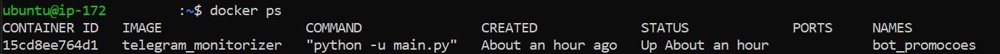
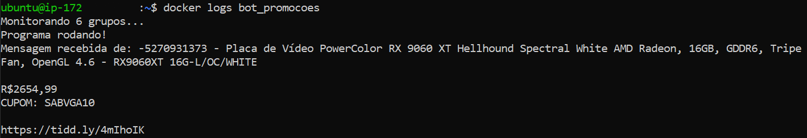
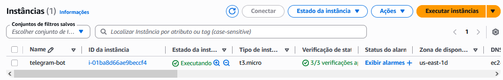
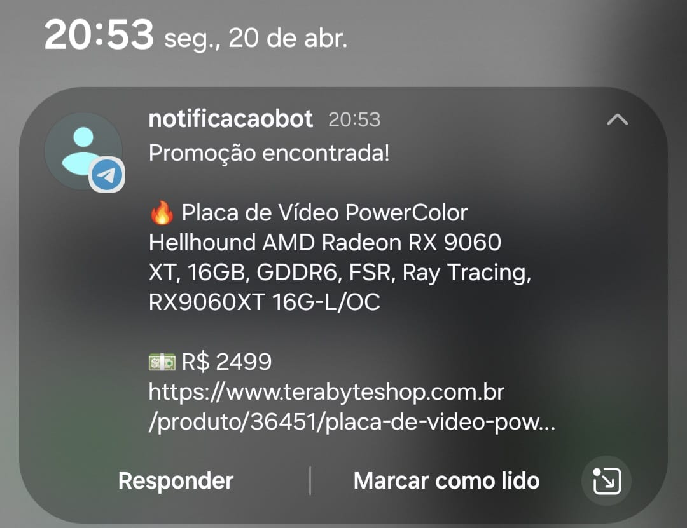

# 🤖 Telegram Deal Monitor

> Real-time deal monitor for Telegram groups — containerized with Docker and deployed on AWS EC2.


---

## 📌 About the Project

Monitoring bot that listens to messages in Telegram groups in real time, filters products of interest using **regex**, and sends instant notifications via a bot — all running 24/7 on an AWS EC2 instance.

The project was born from a real need: not missing flash hardware deals in deal groups. Today it runs in production monitoring more than 5 groups simultaneously.

---

## 🏗️ Why AWS EC2?

The bot needs a **persistent, continuous connection** to Telegram via the MTProto protocol — it literally keeps "listening" to the groups in real time, without interruption. This immediately rules out serverless solutions like AWS Lambda (15-minute execution limit) or any event-driven architecture that assumes short executions.

EC2 was chosen for a few reasons:

**Long-running process**: Telethon's `run_until_disconnected()` keeps a TCP connection open indefinitely. Only a traditional VM supports this execution model.

**Zero cost on the Free Tier**: A `t3.micro` instance (2 vCPU, 1GB RAM) is more than enough for the bot's workload and falls under the AWS free tier for 12 months — zero operating cost for a personal project.

**Operational simplicity**: Docker on EC2 makes it possible to replicate the local environment exactly in production, with no surprises. The same `docker run` that works on the machine works in the cloud.

**Full control**: Unlike managed solutions such as ECS, EC2 gives direct control over the environment — useful for managing the Telethon session file via a Docker volume, which must persist across container restarts.

Alternatives considered and discarded: **Lambda** (time limit), **ECS Fargate** (unnecessary overhead for a single container).

---

## ⚙️ Stack & Technologies

| Technology | Use |
|---|---|
| **Python 3.11** | Main language |
| **Telethon** | MTProto client for Telegram |
| **Telegram Bot API** | Sending push notifications |
| **Regex** | Smart message filtering |
| **Docker** | Application containerization |
| **AWS EC2** | 24/7 cloud hosting |
| **python-dotenv** | Secure credential management |

---

## 🚀 How It Works

1. The bot connects to Telegram via **MTProto** using the Telethon library
2. Listens to messages in real time in the monitored groups
3. Applies **regex** filters to identify products of interest
4. When a deal is detected, fires a notification via the **Telegram Bot API**
5. Runs continuously in a Docker container on **AWS EC2**

---

## 🛠️ Running Locally

### Prerequisites
- Python 3.11+
- Docker
- Telegram API account (api_id and api_hash)

### 1. Clone the repository
```bash
git clone https://github.com/your-username/telegram-deal-monitor.git
cd telegram-deal-monitor
```
### 2. Get the required credentials
 
**API_ID and API_HASH** (Telethon):
1. Go to [my.telegram.org](https://my.telegram.org) and log in
2. Go to **API Development Tools**
3. Create an app and copy the `api_id` and `api_hash`
**BOT_TOKEN** (notifications):
1. Open Telegram and search for `@BotFather`
2. Send `/newbot` and follow the instructions
3. Copy the generated token
**CHAT_ID** (your personal ID):
1. Send any message to the bot you created
2. Open in the browser: `https://api.telegram.org/bot<YOUR_TOKEN>/getUpdates`
3. Look for the `"id"` field inside `"chat"` — that is your CHAT_ID

### 3. Configure the environment variables
```bash
cp .env.example .env
# Edit .env with your credentials
```

```env
API_ID=your_api_id
API_HASH=your_api_hash
BOT_TOKEN=your_bot_token
CHAT_ID=your_chat_id
```

### 4. Generate the Telethon session
```bash
pip install telethon python-dotenv
python3 -c "
import os
from dotenv import load_dotenv
from telethon.sync import TelegramClient
load_dotenv()
client = TelegramClient('session/telegram_deal_monitor', int(os.getenv('API_ID')), os.getenv('API_HASH'))
client.start()
client.disconnect()
"
```

### 5. Build and run with Docker
```bash
docker build -t telegram-deal-monitor .
docker run -d \
  --name deals_bot \
  --env-file .env \
  -v $(pwd)/session:/app/session \
  telegram-deal-monitor
```

### 6. Check the logs
```bash
docker logs -f deals_bot
```

---

## ☁️ Deploying to AWS EC2

### 1. Create an EC2 instance
- AMI: Ubuntu 24.04 LTS
- Type: t3.micro (Free Tier)
- Security Group: open port 22 (SSH) only to your IP

### 2. Connect via SSH
```bash
ssh -i your-key.pem ubuntu@<INSTANCE_IP>
```

### 3. Install Docker
```bash
sudo apt update
sudo apt install -y docker.io
sudo systemctl enable docker
sudo usermod -aG docker ubuntu
```

### 4. Copy the project
```bash
# On your local machine
rsync -av --exclude='.venv' --exclude='__pycache__' \
  -e "ssh -i your-key.pem" \
  ./telegram-deal-monitor ubuntu@<IP>:~
```

### 5. Generate the session and start the container
```bash
# On the EC2 instance
cd telegram-deal-monitor
python3 -c "..." # same script as the local step
docker build -t telegram-deal-monitor .
docker run -d --name deals_bot --env-file .env \
  -v $(pwd)/session/session.session:/app/session/session.session \
  telegram-deal-monitor
```

---

## 📁 Project Structure

```
telegram-deal-monitor/
├── main.py              # Main bot logic
├── Dockerfile           # Container configuration
├── requirements.txt     # Python dependencies
├── .env.example         # Environment variables template
├── .dockerignore        # Files ignored by Docker
└── session/             # Telethon session folder (not committed)
```

---

## 🔒 Security

- Credentials managed via environment variables (never hardcoded)
- `.session` and `.env` files in `.gitignore` and `.dockerignore`
- SSH access restricted to the administrator's IP via Security Group

---

## 📈 Lessons Learned & Challenges

- **MTProto vs Bot API**: Telethon uses the MTProto protocol (a real client), allowing groups to be monitored without being an admin — unlike conventional bots
- **Single session**: Telegram does not allow the same session on two IPs simultaneously — solved by generating the session directly on EC2
- **Docker volumes**: Persisting the `.session` file via a bind mount so it survives container restarts
- **WSL + Docker**: Volume paths must be native to WSL, not Windows (`/mnt/c/...`)

---

## 🖼️ Project Images

### **1. Container Status**
> **Docker orchestration**: View of the `deals_bot` container running, showing the application's isolation and stable uptime.


### **2. Monitoring and Filtering Logic**
> **Real-time logs**: The bot processing the message stream via MTProto. Note the Regex filter successfully identifying a deal on the **RX 9060 XT**, according to the parameters defined in the code.


### **3. Cloud Infrastructure (AWS)**
> **AWS Console**: `t3.micro` instance provisioned in the `us-east-1` region. This infrastructure choice ensures the bot runs 24/7 at zero cost within the AWS Free Tier.


### **4. Final Result: Push Notification**
> **User Experience**: Instant notification sent via the Telegram Bot API after the deal is validated. The complete flow ensures the alert reaches the mobile device within a few seconds.



---

## 📄 License

MIT License — feel free to use and adapt.
